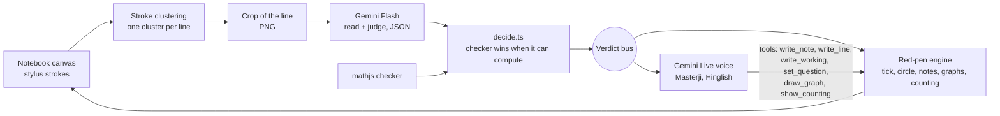

# Master G

**Masterji is your maths teacher's teaching assistant at home.** A child writes sums on a stylus notebook. Masterji reads every step, stays quiet while it is right, and steps in by voice and red pen when it is wrong. He gives hints, not answers. He never calls a correct step wrong (see [Limits](#limits-and-honesty) for what that claim does and does not cover).

Built at hackCBS 9.0 by Akash (`adot-7`), Sarthak (`Marky2813`) and Harjeet (`HARJEET-SINGH-dev`). Tracks: EdTech, MLH Best Use of Gemini API, Yugabyte (MEKO; blocked, see Limits).

Developers: read [PLAN.md](PLAN.md) (product source of truth) and [AGENTS.md](AGENTS.md) (working rules) first.

## The problem

- A child practising alone at home has no one to catch a wrong step until the teacher marks it days later.
- A child who pastes a sum into a chatbot gets the answer, copies it, and learns nothing.
- A teacher sees the final answer in a notebook, not where each child got stuck.

## What it does

- **Watches each step.** The notebook groups pen strokes into lines. When the pen pauses, a crop of the line goes to Gemini Flash, which reads it. A maths checker (mathjs) verifies what it can compute. Where the checker can compute, the checker wins.
- **Stays quiet when right.** A correct step gets a red tick. A step with a plausible correct reading is treated as correct.
- **Steps in when wrong.** Red circle on the wrong part, then Masterji speaks in Hinglish (or English). He follows a hint ladder: point, narrow, lead, show. He does not hand over the answer first.
- **Teaches on the board in red pen.** Notes, working lines, multi-line method working (for example LCM by listing multiples), graphs of equations with the crossing circled, and counting sticks for small sums (Classes 1-3).
- **Takes the question any way.** Handwritten, typed, photo, or pasted screenshot. Masterji reads it back to confirm.
- **Push-to-talk.** The child holds a button to speak, so Masterji does not hear himself on the speakers.
- **Classes 1-8, NCERT.** Masterji asks the class and pitches the sum to it.

### Golden path (about 2 minutes, see [docs/DEMO.md](docs/DEMO.md))

1. Write `3/4 + 1/6`. The child adds across and writes `4/10`.
2. Masterji circles it in red and says it is wrong. Hint ladder, child fixes it, ticks, "Shabash!"
3. Ask "kaise?" and Masterji writes the method on the board.
4. A linear equation: Masterji draws the graph.

### For the teacher (tested offline; not yet run with the stylus and voice)

- **Homework from the teacher:** photograph, screenshot or paste a worksheet. Flash splits it into a queue of questions, and Masterji works through that homework instead of inventing sums. On 4 rendered test worksheets, 28/28 questions were read correctly after prompt tuning (`benchmark/worksheets/`).
- **Teacher / parent report** (`📋 Report`, at `/report`): for each question it shows every step read with its mark, the mistake types, the hints needed and the handwriting remarks. It adds an AI note for the teacher, grounded only in those facts, with suggested next-worksheet questions whose answers come from the checker. Share it as a link (the report is compressed into the URL; no database), on WhatsApp, or print it to PDF.

## How it works



- Clustering is client-side. Every AI mark is placed on a cluster bounding box; the model never invents coordinates.
- `src/lib/brain/decide.ts` is the shared rule: the checker overrides the model where it can compute; alternative readings count only through confusable characters; steps the checker cannot compute become "unsure" (quiet), not wrong.
- Parts talk only through typed events on `src/lib/bus.ts` (types in `src/lib/types.ts`).
- The browser never sees `GEMINI_API_KEY`. `/api/live-token` mints a single-use, 2-minute-to-start Live token with voice, persona and tools locked in.

### Models and APIs in the live path (nothing else)

| Job | Model | API | Where |
|---|---|---|---|
| Read and judge a handwritten step | `gemini-3.5-flash-lite` (override: `GEMINI_FLASH_MODEL`) | Gemini API `generateContent`, JSON schema output, thinking level MINIMAL, temperature 0 | `src/lib/gemini/judge.ts` |
| Read the question (handwritten / photo / paste) | same Flash model | same | `src/lib/gemini/question.ts` |
| Masterji's voice | `gemini-3.1-flash-live-preview` (override: `GEMINI_LIVE_MODEL`), prebuilt voice `Charon` | Gemini Live API, audio out, ephemeral tokens via `authTokens.create` (v1alpha) | `src/lib/voice/config.ts`, `liveConfig.ts`, `src/app/api/live-token/route.ts` |

The benchmark also probed `gemini-pro-latest`; it is not in the live path.

## Benchmark

48 labelled steps written on a Wacom board (28 correct, 20 wrong), `benchmark/samples/`. Config in the app: "A+guard" (Flash judges, then the shared rule), Flash = `gemini-3.5-flash-lite`.

| Date (IST) | Run | Verdict accuracy | False alarms (correct step called wrong) | p95 latency | File |
|---|---|---|---|---|---|
| 31 Oct 18:30 | Run 3, 96 judgements, rule at run time | 98 % | 1 | 2.51 s | `benchmark/results/2026-10-31T13-00-01-249Z.md` |
| 31 Oct 18:30 | Same readings, re-decided offline with the current rule | 97.9 % | 0 | 2.51 s | `docs/SPIKES.md` (`scripts/redecide.ts`) |
| 1 Nov 01:25 | After adding the handwriting rating, A+guard, 2 runs of 48 | 96 % and 98 % | 0 and 0 | 1.81 s and 1.69 s | `benchmark/results/2026-10-31T19-55-28-900Z.md`, `…19-56-40-262Z.md` |

The team's own target was p95 at or under 2 s. Run 3 missed it (2.51 s); the later runs met it on 48 samples each. This is one writer, one board, 48 steps. It is not a general accuracy figure. Full detail: [docs/SPIKES.md](docs/SPIKES.md).

## Run it locally

```bash
npm ci
cp .env.example .env.local     # set GEMINI_API_KEY; never commit this file
npm run dev
```

1. Open <http://localhost:3000/> (landing page), then <http://localhost:3000/learn> (the notebook).
2. Use Chrome or Edge on a laptop with speakers and a microphone. A Wacom board mapped to the browser window is best; a mouse works.
3. Give the question (type, photo, paste or handwrite), confirm it, press Start, then hold the button (or the Space bar) to talk.
4. `/learn?debug=1` shows the event log. Session logs land in `logs/` (gitignored).

Checks: `npm run check` (typecheck, lint, checker, clustering, decide, facts and graph smoke tests).

## Limits and honesty

Status words follow [AGENTS.md](AGENTS.md): edited < tested offline < verified in browser < accepted. Every public claim, with its evidence and status, is in [docs/CLAIMS.md](docs/CLAIMS.md).

- **"Never calls a correct step wrong"** means: on our 48 samples the shipped rule had 0 false alarms in three runs, and the checker re-verifies steps it can compute. It is not a guarantee. A misread digit can still cause a wrong call.
- **MEKO / YugabyteDB memory is not built.** It is blocked on access (account, key, endpoint). Masterji does not remember a child across sessions today.
- **No deploy yet.** It runs locally. Vercel is planned, see [docs/LAUNCH.md](docs/LAUNCH.md).
- **Voice sessions end after about 10 minutes.** The app reconnects; the reconnect has not been waited out live.
- Several features are tested offline only (graph tool in the live app after #59, messy-handwriting flag, 120 % zoom with the stylus). See CLAIMS.
- The Live model is a preview model. Behaviour can change.
- Out of scope: constructions, angles, symmetry, written "explain why" answers.
- Session logs hold the child's step images and voice transcripts. They stay on the local disk and are gitignored. No audio is stored.

## Team

Akash (`adot-7`), Sarthak (`Marky2813`), Harjeet (`HARJEET-SINGH-dev`). No fixed owners; we worked as a relay (see AGENTS.md).

## Where things live

| Path | What |
|---|---|
| `src/app/` | Pages: `/` landing, `/learn` notebook, `/capture` benchmark capture, API routes |
| `src/components/notebook/` | Canvas, rough-work sheet |
| `src/lib/notebook/` | Stroke clustering |
| `src/lib/checker.ts`, `src/lib/brain/` | mathjs checker, `decide.ts`, step service |
| `src/lib/gemini/` | Flash prompts and calls |
| `src/lib/voice/` | Live config, persona, tools, audio |
| `src/lib/redpen/` | Red-pen engine: marks, text font, graphs, counting sticks |
| `benchmark/` | Samples, runner, results |
| `docs/` | DECISIONS, SPIKES, CLAIMS, DEMO, PITCH, LAUNCH, SUBMISSION |
