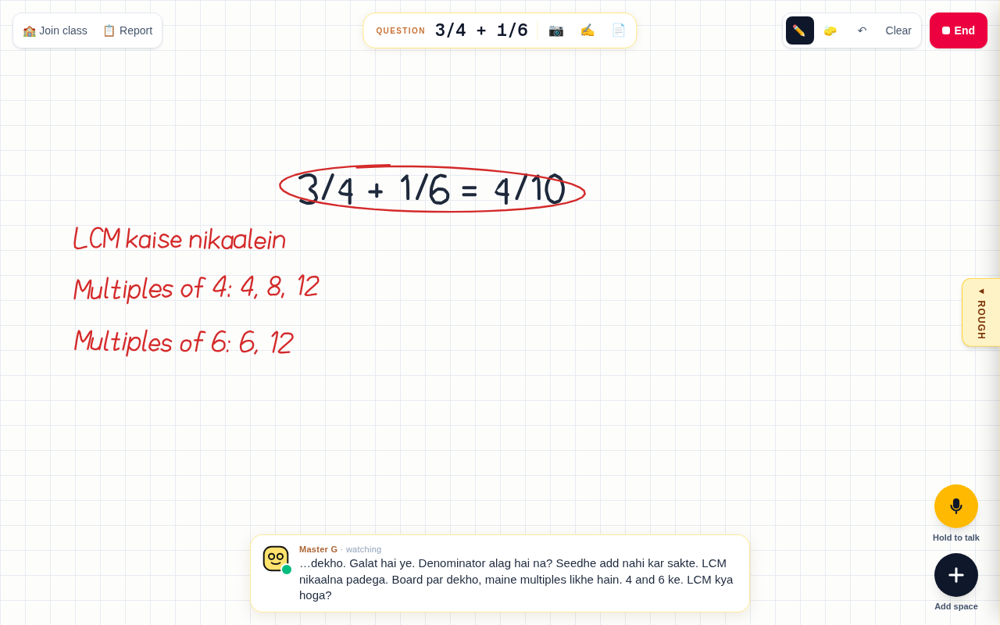
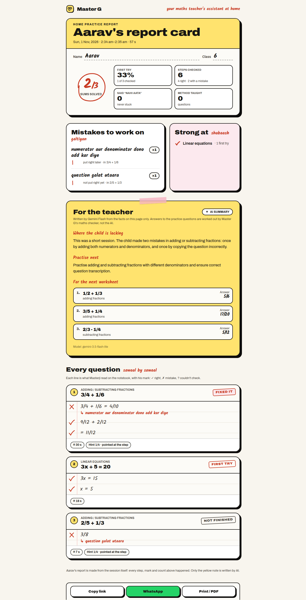
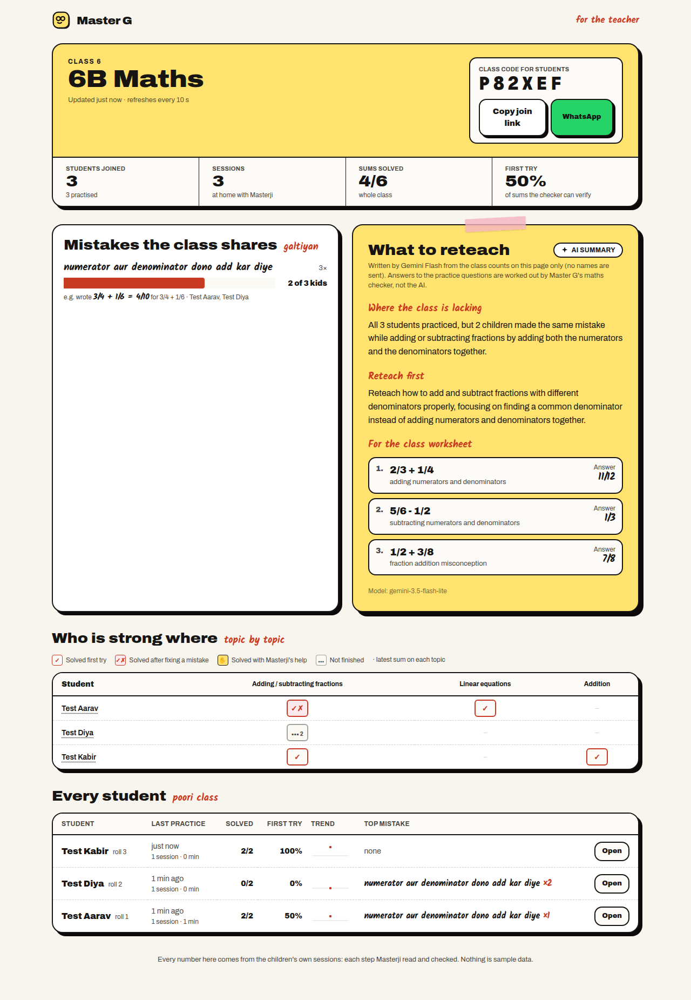
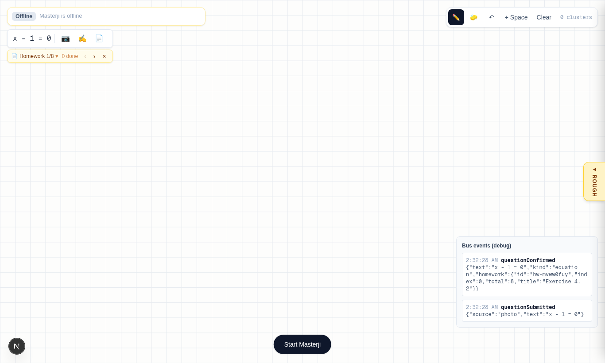

# Master G

**Your maths teacher's teaching assistant at home.** A child solves a sum in a digital notebook; Master G checks every line as it is written, stays quiet while it is right, and steps in with a red pen and a voice the moment it goes wrong.

The tutor inside, Masterji, is a classic Indian tuition teacher: strict, a little dramatic, funny, and he speaks Hinglish. He never hands over the answer. He climbs a hint ladder (point, narrow, lead, show) and teaches the method on the board when the child is stuck. Every session becomes a report the child's teacher can act on. Built for NCERT Classes 1–8.

Built at hackCBS 9.0 (31 Oct – 1 Nov 2026) by Akash ([`adot-7`](https://github.com/adot-7)), Sarthak ([`Marky2813`](https://github.com/Marky2813)) and Harjeet ([`HARJEET-SINGH-dev`](https://github.com/HARJEET-SINGH-dev)).

## Watch
<a href="https://www.youtube.com/watch?v=r_-LqMQN29w"></a>

- **Demo video:** [youtube.com/watch?v=r_-LqMQN29w](https://www.youtube.com/watch?v=r_-LqMQN29w)
- **Live:** [masterg.akashparashar.dev](https://masterg.akashparashar.dev) (invite-only; the code is in our submission)

| | |
|---|---|
|  |  |
| **Every line checked.** `3/4 + 1/6 = 4/10` gets a red circle; Masterji asks where it went wrong, then writes the LCM method on the board when the child is stuck. | **A report for the teacher.** Every step with its mark, the mistake types, the hints needed, and a note on where the child is lacking. Share it as a link or on WhatsApp, or print it. |
|  |  |
| **The whole class at a glance.** A class code, children join once, and the teacher sees the mistakes the class shares ("2 of 3 kids added across") and what to reteach. Test students, real verdicts. | **Homework from the teacher.** A photo or the text of a worksheet becomes a queue, and Masterji works through it in order. |

## For judges
- **Open [masterg.akashparashar.dev](https://masterg.akashparashar.dev)** in Chrome or Edge on a laptop or tablet, enter the invite code from our submission, and allow the microphone.
- **Try the golden path:** type `3/4 + 1/6` as the question, press **Start Masterji**, tell him your name and class (hold the mic button or the Space bar to talk), then write `3/4 + 1/6 = 4/10`. Watch the circle, the hint, and what happens when you say "nahi aata". Write the right steps and he ticks them.
- **Ask for more:** on a linear equation say "graph dikha do"; on a small sum for Class 1 he counts with sticks. Interrupt him any time by pressing the mic.
- **The teacher's side:** **📋 Report** opens the session's report card. **I'm a teacher** on the home page makes a class; open its join link in another browser profile to be a student.
- **What to expect:** a step is checked about 2 seconds after the pen rests. Masterji speaks Hinglish. A mouse works; a stylus is better.
- **On the hackCBS Wi-Fi** the domain is blocked by the venue's web filter; use mobile data.

## How it works


- **The notebook** (`src/components/notebook/`, `src/lib/notebook/`): a canvas that groups pen strokes into lines. When the pen rests, a crop of the line goes to the server. Stacked fractions, wide gaps between terms and lines the child extends are all kept as one step.
- **Read and judge** (`src/lib/gemini/`, `src/lib/brain/`, `src/lib/checker.ts`): Gemini Flash (`gemini-3.5-flash-lite`) reads the handwriting into a maths expression and gives a verdict, a mistake type and a handwriting rating as JSON. A mathjs checker then recomputes every step it can, and **when the checker can compute a step, the checker wins**, so a correct step is not called wrong because the model misread it. If any plausible reading makes a step correct, it is correct.
- **The voice** (`src/lib/voice/`, `src/app/api/live-token/`): Masterji runs on the Gemini Live API (`gemini-3.1-flash-live-preview`), push-to-talk. The browser gets a short-lived token from our server, so the API key never leaves it. Verdicts reach him as hidden notes; he never judges the maths himself. He acts through tools: write a note, write a working, draw a graph, show counting sticks, set the next question. Code-side guards stop him writing the final answer early, speaking internal notes, or saying a reply twice.
- **The red pen** (`src/lib/redpen/`): ticks, circles, notes and workings drawn as animated handwriting, placed clear of the floating panels. Graph crossings and counting are computed in code, never by the model.
- **For the teacher** (`src/lib/report/`, `src/lib/classroom/`, `/report`, `/teacher`, `/join`): the report is built from the session's own events and travels inside its share link. Classes and synced sessions live on the server. The AI notes are written from computed facts only, and the practice questions they suggest get their answers from our checker.
- **Hosting** (`deploy/`, `src/proxy.ts`, [`docs/DEPLOY.md`](docs/DEPLOY.md)): one EC2 instance in Mumbai behind Caddy (HTTPS), an invite-code gate on the app and every API, and every merge to `main` deployed automatically, with a health check and rollback.

API keys live only on the server. Every session is logged (events, step crops, transcripts) so any run can be replayed.

## Measured
48 labelled steps written on a Wacom board (28 correct, 20 wrong), in `benchmark/samples/`. Shipped config: Flash judges, then the checker rule.

| When (IST) | Verdict accuracy | False alarms (correct step called wrong) | p95 latency |
|---|---|---|---|
| 1 Nov 01:25, 2 runs | 96 % and 98 % | 0 and 0 | 1.81 s and 1.69 s |
| 1 Nov 09:40, after English mistake labels | 98 % | 0 | 2.61 s |

One writer, one board, 48 steps: not a general accuracy figure. Every run is in [`docs/SPIKES.md`](docs/SPIKES.md) and `benchmark/results/`.

## Run it locally
You need Node 20 and a Gemini API key.
```bash
npm ci
cp .env.example .env.local      # set GEMINI_API_KEY; never commit it
npm run dev                     # http://localhost:3000, the notebook at /learn
```
- `/learn?debug=1` shows the live event log; session logs land in `logs/` (gitignored).
- `npm run check`: typecheck, lint, and the offline suites (checker, clustering, verdict rule, board facts, graphs, report, classroom, voice rules).
- `npm run bench`: the 48-step benchmark against the real model.
- `scripts/*-probe.ts` and `scripts/*-drive.mjs`: live-model probes and headless-Chrome runs used as evidence in the PRs.
- Without `INVITE_CODE` set, the invite gate is off.

## Repository
| Path | What |
|---|---|
| `src/app/` | Pages (`/`, `/learn`, `/report`, `/teacher`, `/join`, `/invite`) and API routes (`step`, `question`, `worksheet`, `live-token`, `report-summary`, `class/*`, `log`) |
| `src/components/` | `notebook/`, `voice/`, `question/`, `report/`, `classroom/`, `landing/` |
| `src/lib/` | `notebook/` clustering · `gemini/` Flash · `brain/` verdict rule, facts, mistakes · `checker.ts` mathjs · `voice/` Live API, persona, tools · `redpen/` handwriting · `report/` · `classroom/` · `invite/` |
| `benchmark/` | Labelled samples, the benchmark runner and its results |
| `scripts/` | Smoke tests, live probes, headless drives |
| `deploy/` | Server setup and the auto-deploy script |
| `docs/` | Decisions, claims, spikes, demo script, deploy notes |

## Docs
- [`PLAN.md`](PLAN.md): the product source of truth. [`AGENTS.md`](AGENTS.md): how we work.
- [`docs/CLAIMS.md`](docs/CLAIMS.md): every public claim with its evidence, and what not to claim.
- [`docs/DECISIONS.md`](docs/DECISIONS.md): every scope or product decision, who made it and why.
- [`docs/SPIKES.md`](docs/SPIKES.md): experiments, benchmark runs and the API-usage ledger.
- [`docs/DEMO.md`](docs/DEMO.md): the demo script and fallbacks. [`docs/DEPLOY.md`](docs/DEPLOY.md): the server.

## Limits
- Accuracy is measured on one writer's handwriting (48 steps); there is no study of learning outcomes.
- Masterji does not remember a child across sessions yet.
- Tested mostly on a laptop with a Wacom board; phones and tablets have had little real use.
- Tracks: EdTech and Best Use of Gemini API. The YugabyteDB memory we planned was not built.
